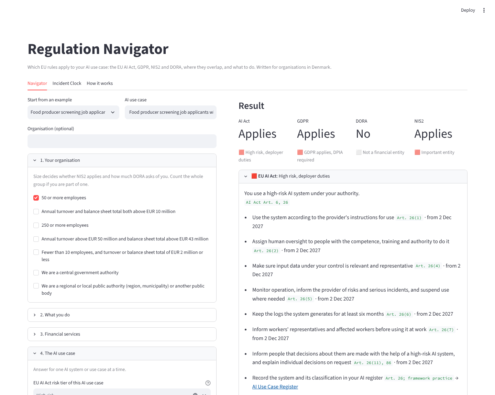
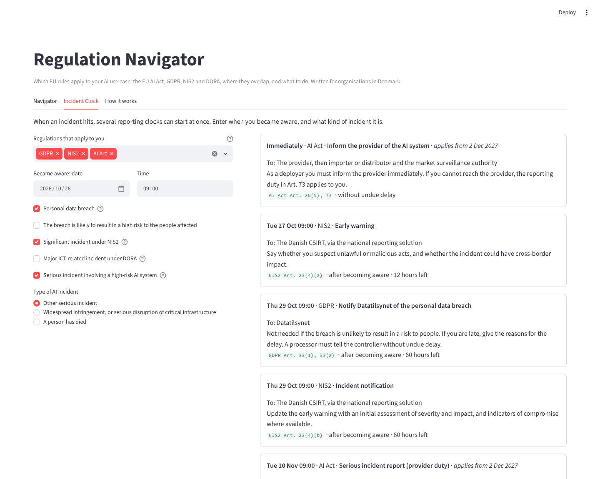

# Regulation Navigator

[](https://github.com/gifmaster/regulation-navigator/actions/workflows/tests.yml)
[](https://regulation-navigator.streamlit.app)

**Which EU rules apply to your AI use case, where they overlap, and what to do.**

Most organisations meet AI governance through several laws at once. A Danish food producer with 120 staff that buys an AI tool to screen job applicants is affected by the **EU AI Act**, **GDPR** and **NIS2**. A pension fund using AI to answer members adds **DORA**. Each law comes with its own project, consultant and checklist. This tool puts them on one page.

Answer questions about your organisation and one AI use case, and get:

- **Whether each regulation applies**, and why, with the article behind it
- **What to do** under each one, with dates for duties that are not in force yet
- **Where they overlap**, so one piece of work serves several laws: one DPIA for GDPR and the AI Act, one contract review for DORA, GDPR and the AI Act, one management training for NIS2, DORA and AI literacy
- An **Incident Clock**: when something goes wrong, every reporting deadline that starts, in order



**[Try it live](https://regulation-navigator.streamlit.app)** with five example organisations.

## Incident Clock

One incident can be a personal data breach, a significant NIS2 incident, a major DORA incident and a serious AI incident at the same time. Each has its own deadline, counted from a different moment, and its own recipient.

| Regulation | Report | Deadline |
|---|---|---|
| GDPR | Notify Datatilsynet | 72 hours after becoming aware (Art. 33) |
| NIS2 | Early warning, notification, final report | 24 hours, 72 hours, then one month after the notification (Art. 23(4)) |
| DORA | Initial, intermediate, final report | 4 hours after classification as major and at most 24 hours after awareness, then 72 hours, then one month (Art. 19; Delegated Regulation (EU) 2025/301 Art. 5) |
| AI Act | Serious incident report | 15 days, 2 days if widespread, 10 days on death (Art. 73); deployers inform the provider immediately (Art. 26(5)) |



## How it decides

Same principle as the rest of the toolkit: rules, not an LLM, so every answer can be checked.

Each regulation is one readable rule file in [`src/navigator/rules/`](src/navigator/rules): [`ai_act.yaml`](src/navigator/rules/ai_act.yaml), [`gdpr.yaml`](src/navigator/rules/gdpr.yaml), [`nis2.yaml`](src/navigator/rules/nis2.yaml), [`dora.yaml`](src/navigator/rules/dora.yaml), [`overlaps.yaml`](src/navigator/rules/overlaps.yaml) and [`incidents.yaml`](src/navigator/rules/incidents.yaml). Each file is a decision table: rules are read top to bottom and the first match decides.

```yaml
- id: nis2.annex_ii
  when: {all: [$annex_ii, $medium]}
  status: applies
  title: Important entity
  reason: Medium-sized and large entities in other critical sectors (Annex II) are important entities.
  cite: Art. 2(1), 3(2); Annex II
```

Adding a regulation means adding a file. The engine knows nothing about any of them.

## Written for Denmark

- **NIS2** follows the Danish implementation: the general act (No. 434 of 2025), the energy act (No. 258 of 2025) and the telecom act (No. 435 of 2025). Denmark does not apply the NIS2 size threshold to energy and telecom companies, and the tool reflects that.
- **Authorities** are the Danish ones: Datatilsynet, Finanstilsynet, Styrelsen for Samfundssikkerhed, Digitaliseringsstyrelsen.
- **EU AI Act** dates follow the Digital Omnibus on AI (Regulation (EU) 2026/1744): high-risk duties from 2 December 2027 for Annex III systems.

Sources for every rule: [docs/SOURCES.md](docs/SOURCES.md).

## What it does not do

- **Classify the AI system.** The [EU AI Act Risk Check](https://ai-act-risk-check.streamlit.app) does that, with about 45 questions. Here the risk tier is an input.
- **Cover every national option.** Member State choices (for example local public administration under NIS2) are flagged as *check*, not decided.
- **Apply proposals.** The Digital Omnibus proposals for GDPR and a single incident reporting point are not applied until adopted.
- **Replace legal advice.** It is a screening aid that shows its reasoning, for a person who then decides.

## Run it locally

```bash
git clone https://github.com/gifmaster/regulation-navigator.git
cd regulation-navigator
pip install -r requirements.txt
streamlit run app.py
```

From Python:

```python
from navigator import Navigator, evaluate, to_markdown

nav = Navigator.builtin()
result = evaluate(nav, {"staff_50": True, "s_food": True, "ai_tier": "high", "ai_role": "deployer",
                        "ai_vendor": True, "pd": True, "pd_evaluation": True, "pd_vulnerable": True})
for rid, r in result.regimes.items():
    print(rid, r.status, r.title)
print(to_markdown(nav, result, "CV screening"))
```

## Tests

```bash
pip install pytest
pytest
```

62 tests, including:

- **21 [acceptance cases](tests/acceptance_cases.yaml)**: realistic organisations (a 6-person DNS provider, a pension scheme with 12 members, a life insurer pricing with AI, a municipality chatbot) with the result written from the legal texts. Edge cases include turnover alone not making a company medium-sized, small insurance brokers being exempt from DORA, and small Danish energy companies being covered by NIS2 anyway
- every regulation reaching a decision even when nothing is answered
- incident deadlines checked by hand, including DORA's "4 hours after classification, but never later than 24 hours after awareness"
- validation that every rule cites its source and only refers to questions that exist

## Part of a toolkit

| | |
|---|---|
| [EU AI Act Risk Check](https://github.com/gifmaster/ai-act-risk-check) | Classify an AI system |
| [AI Contract Clause Checker](https://github.com/gifmaster/contract-clause-checker) | Review the vendor contract, including a DORA Art. 30 pack |
| [AI Use Case Register](https://github.com/gifmaster/ai-use-case-register) | Keep track of every AI use case |
| This tool | See which rules apply and where they overlap |
| [Practical AI Governance Framework](https://github.com/gifmaster/ai-governance-framework) | The method behind it |

## About

Built by **Alexander Senderovitz**, AI governance and digital transformation, Copenhagen.
[senderovitz.eu](https://senderovitz.eu) · [alexander@senderovitz.eu](mailto:alexander@senderovitz.eu)

Licensed under the [GNU AGPL-3.0](LICENSE): free to use, study and change. If you run a modified version as a service, you must share its source code. Commercial license without these terms: [alexander@senderovitz.eu](mailto:alexander@senderovitz.eu). Not legal advice.
